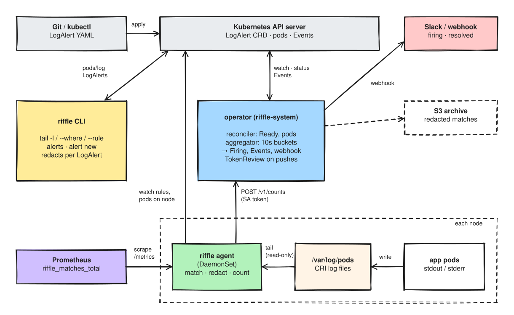

# Riffle

[](https://github.com/joshchen-dev/riffle/actions/workflows/ci.yml)

Log rules as Kubernetes resources. Teams declare a `LogAlert`; Riffle matches it against pod logs and reports matches as Prometheus metrics, Events and `.status`. The `riffle` CLI tails the same logs and reuses the same rules.

> A riffle is the ridge in a gold-panning sluice that catches the gold while the water washes through.

```yaml
apiVersion: riffle.jhchen.dev/v1alpha1
kind: LogAlert
metadata: {name: api-timeouts, namespace: payments}
spec:
  selector: {matchLabels: {app: api}}
  match: 'timeout'
  where: 'level=error AND latency_ms>500'
  threshold: {count: 20, window: 5m}
  redact: ['card=\d+']
```

```console
$ kubectl -n payments get logalerts
NAME           READY   FIRING   PODS   AGE
api-timeouts   True             3      12s
broken         False                   4s
```

## CLI

```console
$ riffle tail -n payments -l app=api --where 'level=error AND latency_ms>500'
api-7d9f-x2k4p/api {"level":"error","latency_ms":604,"msg":"upstream timeout"}
api-7d9f-hw6fk/api {"level":"error","latency_ms":715,"msg":"upstream timeout"}
```

With the operator installed, `tail` also applies the `redact` patterns of every LogAlert that selects a pod, and can tail a rule directly:

```console
$ riffle tail -n payments --rule api-timeouts
api-7d9f-x2k4p/api {"level":"error","latency_ms":604,"msg":"upstream timeout",[REDACTED]}
```

Works against any cluster; the operator is optional.

`riffle tail -i` opens an interactive view: edit `match` and `where` live over the last 10,000 lines, then `ctrl+s` prints the filter as LogAlert YAML.

Turn a filter into a rule, and check on rules:

```console
$ riffle alert new api-timeouts -n payments -l app=api --where 'level=error AND latency_ms>500' --count 20 > api-timeouts.yaml
$ riffle alerts -A
NAMESPACE   NAME           READY   FIRING   PODS   THRESHOLD   LAST MATCH
payments    api-timeouts   True    True     3      20/5m0s     4s ago
```

`alert new` prints YAML for Git; `--create` creates it directly.

## Alerts

When a rule fires, Riffle sets `Firing`, records an Event and POSTs to a webhook (Slack-compatible):

```sh
kubectl -n riffle-system create secret generic riffle-webhook --from-literal=url=https://hooks.slack.com/services/...
```

Log line to webhook: **p50 0.5s** on k3d (`hack/bench-latency.sh`).

## Why not stern, k9s or Loki?

- stern and k9s are good at tailing logs, but they don't keep rules.
- Loki stores and searches logs, which means running a log store.
- Riffle sits between the two. Rules are namespaced CRDs, so they're reviewed in Git, scoped by RBAC and deployed with Argo CD. The CLI and the operator share one filter engine, so an ad-hoc filter turns into an alert unchanged.

## Architecture



## Status

| Milestone | |
|---|---|
| M0 scaffold, CI | ✅ v0.1 |
| M1 CRD, validation, status | ✅ v0.1 |
| M2 `riffle tail` (multi-pod, `--where`) | ✅ v0.2 |
| M3 node agent (`/var/log/pods`), metrics | ✅ v0.5 |
| M4 threshold aggregation, `Firing`, Events | ✅ v0.6 |
| M4.1 webhook alerts, latency benchmark | ✅ v0.7 |
| M5 CLI ↔ operator integration | ✅ v0.9 |
| M6 interactive TUI | ✅ v0.10 |
| M7 S3 archive (Terraform) | |
| M8 homelab: RHEL/k3s + Argo CD | |

Design: [docs/design.md](docs/design.md)

## Run it (k3d)

```sh
k3d cluster create riffle
make docker-build IMG=riffle-operator:dev
k3d image import riffle-operator:dev -c riffle
make deploy IMG=riffle-operator:dev   # operator + node agent
kubectl apply -n default -f config/samples/riffle_v1alpha1_logalert.yaml
```

## Develop

```sh
make fmt vet lint test   # test runs unit + envtest
make build               # bin/manager, bin/riffle
```

## Layout

| Path | |
|---|---|
| `api/v1alpha1` | `LogAlert` types |
| `internal/controller` | reconciler |
| `pkg/filter` | match / where / redact engine, shared by the operator, agent and CLI |
| `cmd/main.go` | operator |
| `cmd/riffle` | CLI |
| `config/` | kustomize manifests |

## Stack

Go, controller-runtime/kubebuilder, CRDs with CEL validation, envtest, GitHub Actions. Later: Prometheus, Terraform/AWS S3, Argo CD.

## License

Apache 2.0
